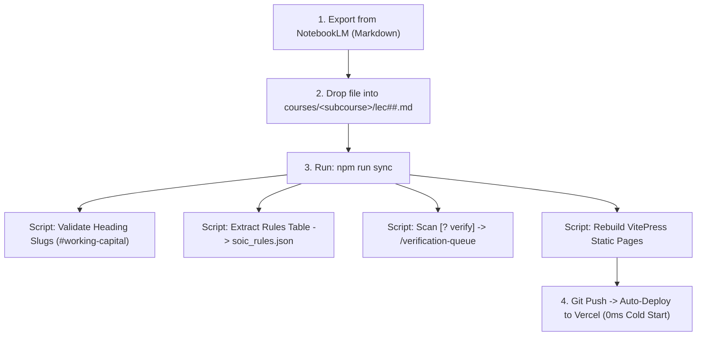
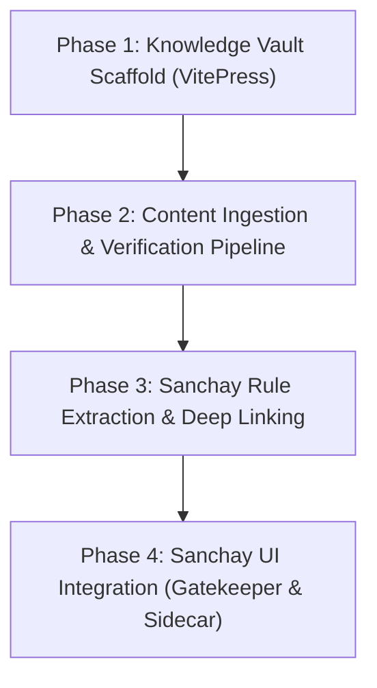

# SOIC Knowledge Vault + Sanchay Integration Architecture

> [!NOTE]
> **Executive Summary:** The entire SOIC Knowledge Vault and its integration with Sanchay can be built, hosted, and operated at **\$0.00 / month cost forever**, utilizing existing free tiers (GitHub, Vercel/Cloudflare Pages) without altering Sanchay's core transaction-ledger architecture. Below is the structural cost model, execution roadmap, and visual mockups across 5 key screens.

---

## 1. Structural Cost & Data Footprint Analysis

Given that **Sanchay** currently runs on **Vercel (Frontend)** and **Render (Backend)** on free tiers with **Neon PostgreSQL**, here is the rigorous cost accounting:

### A. Data Footprint Sizing

| Content Type | Count / Scale | Size per Item | Total Data Volume |
| :--- | :--- | :--- | :--- |
| **D1: Detailed Lecture Reports** | ~100 lectures | ~30 – 50 KB Markdown | ~3.5 – 5.0 MB |
| **D2: Summary Reference Cards** | ~100 lectures | ~3 – 5 KB Markdown | ~0.4 MB |
| **D3: Sub-Course Summaries** | 4 – 5 courses | ~10 – 15 KB Markdown | ~0.06 MB |
| **Slide Visuals / Diagrams** | ~150 – 250 images | ~150 KB (WebP/optimized) | ~25 – 35 MB |
| **Total Master Knowledge Base** | **Full Course** | — | **~35 – 45 MB total** |

### B. Cost by Layer

```
┌────────────────────────┬─────────────────────────────┬──────────────────┬─────────────┐
│ Component              │ Provider / Tool             │ Free Tier Budget │ Net Cost    │
├────────────────────────┼─────────────────────────────┼──────────────────┼─────────────┤
│ 1. Storage & Versioning│ GitHub Repository           │ 1 GB repository  │ $0.00/month │
│ 2. SSG Engine          │ VitePress (Node/Vite)       │ Open Source      │ $0.00/month │
│ 3. Client Search       │ Pagefind (Static/WASM)      │ Open Source      │ $0.00/month │
│ 4. Static Hosting & CDN│ Vercel (or Cloudflare Pages)│ 100 GB bandw/mo  │ $0.00/month │
│ 5. Sanchay Integration │ Shared JSON / Deep links    │ Existing Sanchay │ $0.00/month │
├────────────────────────┴─────────────────────────────┴──────────────────┼─────────────┤
│ TOTAL OPERATING COST                                                    │ $0.00/month │
└─────────────────────────────────────────────────────────────────────────┴─────────────┘
```

> [!TIP]
> **Vercel Multi-Project Setup:** You do not need to combine repositories. On your current free Vercel account, you can create a second project (e.g. `soic-vault.vercel.app`) from a dedicated GitHub repository `soic-knowledge-vault`. Vercel allows unlimited personal hobby projects. Alternatively, you can deploy it to **Cloudflare Pages** (which has unlimited free bandwidth).

---

## 2. Multi-Screen Visual Blueprint: How It Looks in Sanchay

To see how the SOIC TVGP knowledge moves from abstract text into daily investment decisions, explore the five mockups below:

### Screen 1: Sanchay Stock Inspector with Integrated SOIC TVGP Audit
*When analyzing an existing holding or prospective stock (e.g., Astral Ltd), Sanchay pairs real-time price & indicator data with a dedicated TVGP audit card that links directly to course lectures.*


**Key Elements:**
- **TVGP Scorecard (8.8/10):** Visual breakdown of Theme (9.5), Valuation (7.0), Growth (9.0), and Promoter (9.5).
- **Lecture Reference Badges:** Chips like `[SOIC Lec 04: Sector Shifts]` open the exact lecture stage in the Vault with one click.
- **Valuation Alert:** Amber warning when P/E (52.4x) hits the upper quartile of historical cycle multiples.

---

### Screen 2: Pre-Investment TVGP Gatekeeper (Buy Order Modal)
*Before committing capital, Sanchay's `stockForm.jsx` introduces an interactive pre-flight gatekeeper.*


**Key Elements:**
- **Automated Checkpoints:** Evaluates Theme, Promoter integrity, and Valuation margin of safety.
- **Caution Flag (Amber):** Highlights unresolved risks (e.g., *"Bathware plant utilization is 42%; verify breakeven runway (CC_Lec03)"*).
- **Discipline Enforcer:** Prevents impulsive buys by forcing verification against course rules before saving to the Postgres ledger.

---

### Screen 3: Investment Thesis & Research Workspace (`thesis_markdown` + Sidecar)
*Split-screen environment in Sanchay: on the left, your investment thesis stored in PostgreSQL; on the right, the SOIC Reference Sidecar showing matching sector case studies.*


**Key Elements:**
- **Dynamic Sector Matching:** Because Astral is tagged under Building Materials/Plastics, the sidecar automatically fetches case studies from `CC_Lec08` (Distribution Moats).
- **Threshold Watch:** Compares Astral's actual Cash Conversion Cycle (38 days) against the SOIC sector threshold (< 45 days) with a green checkmark.
- **Exit Strategy Anchor:** Outlines specific SOIC "Margin Trap" exit triggers directly within the thesis.

---

### Screen 4: Dedicated SOIC Knowledge Vault (VitePress Documentation Engine)
*The standalone documentation hub providing the 3-Tier Drill-down (D3 $\to$ D2 $\to$ D1) and timestamp deep-linking.*


**Key Elements:**
- **Collapsible Hierarchy:** Sub-courses (`CHK`, `CC`, `FA`, `L3`) neatly arranged in the left sidebar.
- **Mode Switcher:** Instant toggle between **[5-Min Summary Card (D2)]**, **[Detailed Report (D1)]**, and **[Verification Queue]**.
- **Timestamp Anchors:** `[14:22]` links directly to the exact point in the recorded lecture.
- **Verification Tag Badge:** Items marked with `[? verify]` are highlighted in amber for easy review.

---

### Screen 5: Active Recall Revision Center & Verification Queue
*Retention engine designed to turn passive reading into active mastery and resolve transcript uncertainties.*


**Key Elements:**
- **Daily 5-Minute Recall Deck:** Automatically presents 5 randomized self-test questions from the D1 reports with a *Reveal Answer* button.
- **Verification Queue Dashboard:** Gathers all `[? verify]` flags across 100 lectures in one centralized table with recording timestamps and resolution actions.

---

## 3. Confirmed Workflow Decisions & Operational Pipeline

Following user review, the operational model is locked into three core choices:
1. **Editing & Snippet Corrections:** One-click **"Edit this page on GitHub"** link on every lecture and card. Corrections can be made right from the browser (mobile or desktop) with instant GitHub commit and ~25s automated Vercel deployment.
2. **Repository Sizing & Hygiene:** The vault repository stores **only extracted artifacts** (D1 detailed reports, D2 summary cards, D3 sub-course summaries, and optimized WebP slide screenshots). Raw subtitle transcripts (~15,000 lines/lecture) remain in local backup, keeping the Git repository featherlight at **~15–35 MB total** (well under GitHub's 1 GB ceiling).
3. **Automated Ingestion Pipeline:** Re-uploading or updating a lecture is fully handled via a single CLI command (`npm run sync`), eliminating manual re-linking or rule maintenance.

---

## 4. The Ingestion & Invalidation Pipeline (`npm run sync`)



### Pipeline Script Specification (`scripts/sync.js`)
* **Input:** New or updated D1/D2 Markdown files in `courses/<subcourse>/`.
* **Step 1 - Heading Stabilization:** Generates consistent kebab-case slugs (e.g., `#stage-3-working-capital`) so existing deep-links from Sanchay never break when lecture prose is edited or regenerated.
* **Step 2 - Rule Harvesting:** Parses Markdown tables with headers matching `| Metric / Rule | Threshold | Rationale |` and exports a clean, aggregated `soic_rules.json` that Sanchay consumes.
* **Step 3 - Verification Audit:** Greps for `[? verify]` and `[? Hindi]` tags, automatically building the central verification queue table with timestamp links.
* **Execution Time:** ~2.5 seconds locally.

---

## 5. Step-by-Step Execution Plan



### Phase 1: Knowledge Vault Scaffold (Time: 1–2 days)
1. Initialize a new repo `soic-knowledge-vault` with **VitePress**.
2. Configure dark theme matching Sanchay's Tailwind color palette (`slate-950`, `emerald-400`, `cyan-400`).
3. Configure `editLink` to enable one-click browser editing on GitHub.
4. Add **KaTeX** math support and **Pagefind** client-side search across all sub-courses.
5. Deploy to Vercel (`soic-vault.vercel.app`) with zero-cost CI/CD on git push.

### Phase 2: Content Taxonomy & Pipeline (Time: Iterative)
1. Organize the 4 sub-courses into clean directory folders:
   - `courses/chk/` (TVGP Checklist)
   - `courses/cc/`  (TVGP Crash Course)
   - `courses/fa/`  (Fundamental Analysis)
   - `courses/l3/`  (Valuation & Portfolio Strategy)
2. Add standardized YAML frontmatter to each D1, D2, and D3 document.
3. Implement `scripts/sync.js` (`npm run sync`) to automate rule extraction and verification queue compilation.

### Phase 3: The Sanchay Bridge (Time: 2 days)
1. Export `soic_rules.json` (~20 KB) from the vault and drop into Sanchay's frontend assets.
2. Establish stable deep-link URLs (`https://soic-vault.vercel.app/courses/<subcourse>/<lecture>#<slug>`).

### Phase 4: Sanchay UI Enhancements (Time: 3–4 days)
1. **Header:** Add a persistent "SOIC Vault" link in Sanchay's [`tabNavigation.jsx`](file:///d:/Work/Investment_Tracker/Portfolio-Tracker-Frontend/src/components/tabNavigation.jsx).
2. **Stock Inspector:** Add the TVGP audit card and SOIC reference chips in [`StockInspector.jsx`](file:///d:/Work/Investment_Tracker/Portfolio-Tracker-Frontend/src/components/stocks/StockInspector.jsx).
3. **Buy Order Form:** Add the pre-flight checklist modal in [`stockForm.jsx`](file:///d:/Work/Investment_Tracker/Portfolio-Tracker-Frontend/src/components/inputForm/stockForm.jsx).
4. **Thesis Editor:** Enhance `thesis_markdown` in [`StockInspector.jsx`](file:///d:/Work/Investment_Tracker/Portfolio-Tracker-Frontend/src/components/stocks/StockInspector.jsx) with the SOIC Context Sidecar.